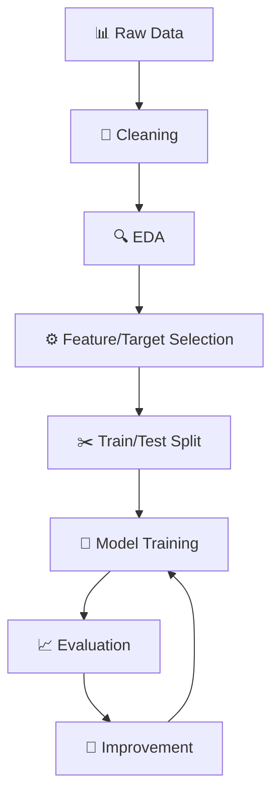
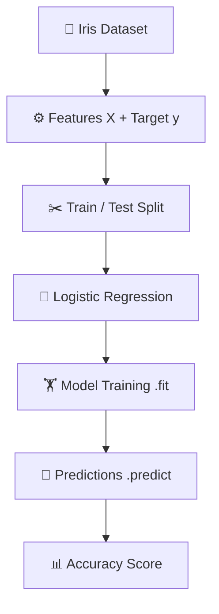
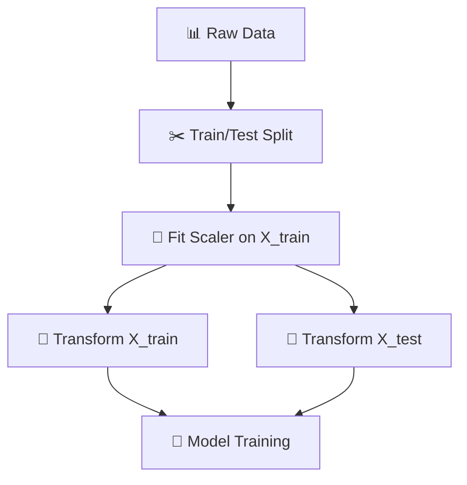
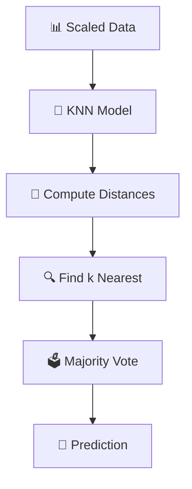
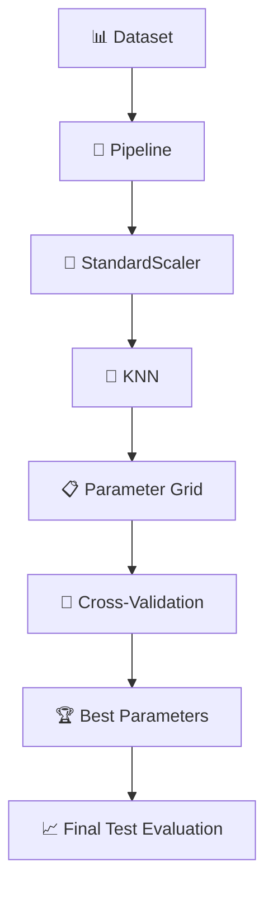
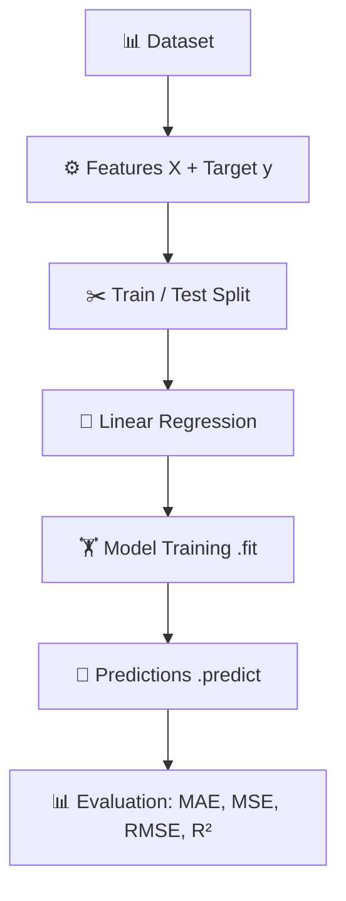
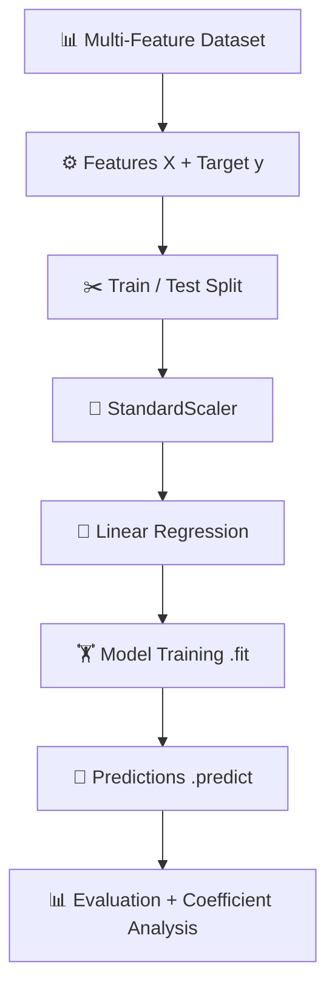
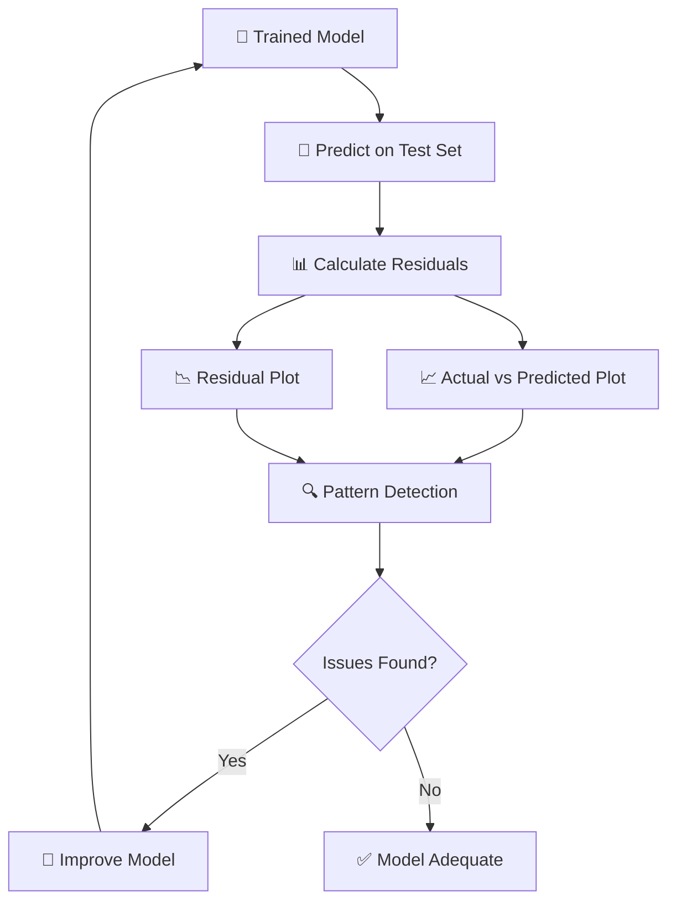

# Machine Learning Journey 🤖

> **Learning Path:** 84 Days of Machine Learning — From EDA to Production-Ready Models
>
> **Current Progress:** Day 41/84 ✅ | **Last Updated:** 2026-08-24

---

## 📚 Table of Contents

### 🎯 Classification Track (Days 31–36)
- [Day 31: Machine Learning Workflow Fundamentals](#day-31-machine-learning-workflow-fundamentals)
- [Day 32: First ML Model — Logistic Regression](#day-32-first-ml-model--logistic-regression)
- [Day 33: Model Evaluation & Metrics](#day-33-model-evaluation--metrics)
- [Day 34: Feature Scaling & Preprocessing Pipeline](#day-34-feature-scaling--preprocessing-pipeline)
- [Day 35: K-Nearest Neighbors (KNN) Classification](#day-35-k-nearest-neighbors-knn-classification)
- [Day 36: Hyperparameter Tuning with GridSearchCV & Pipelines](#day-36-hyperparameter-tuning-with-gridsearchcv--pipelines)
- [🧠 Synthesis: Days 34–36 Connected ML Workflow](#-synthesis-days-3436-connected-ml-workflow)

### 📈 Regression Track (Days 37–39)
- [Day 37: Linear Regression — Single Feature](#day-37-linear-regression--single-feature)
- [Day 38: Multiple Linear Regression](#day-38-multiple-linear-regression)
- [Day 39: Regression Model Evaluation & Residual Analysis](#day-39-regression-model-evaluation--residual-analysis)

### 🔬 Hands-on Practice (Days 40–41)
- [Day 40: Simple Linear Regression — From Scratch](#day-40-simple-linear-regression---from-scratch)
- [Day 41: Residual Analysis Deep Dive](#day-41-residual-analysis-deep-dive)

### 📦 Reference
- [🛠️ Technologies & Libraries](#️-technologies--libraries)
- [📁 Repository Structure](#-repository-structure)
- [🔗 Quick Links](#-quick-links)
- [📅 Complete Progress Tracker](#-complete-progress-tracker-days-3141)

---

## Day 31: Machine Learning Workflow Fundamentals

**Date:** Day 31/84 | **Focus:** Transitioning from EDA to Machine Learning

### 🎯 Learning Objectives

- [x] Understand the difference between features (**X**) and target (**y**)
- [x] Master train/test splitting with `train_test_split()`
- [x] Configure `test_size`, `random_state`, and `stratify` parameters
- [x] Apply the complete ML workflow pipeline
- [x] Recognize why test data isolation is critical

### 📖 Key Concepts

| Concept | Description |
|---------|-------------|
| **Features (X)** | Input variables used to make predictions |
| **Target (y)** | Output variable we want to predict |
| **Train/Test Split** | Partitioning data to evaluate generalization |
| **`random_state`** | Seed for reproducibility |
| **`stratify`** | Preserves class distribution in splits |

### 🛠️ Hands-on Practice (Iris Dataset)

```python
# Load dataset
from sklearn.datasets import load_iris
from sklearn.model_selection import train_test_split

iris = load_iris()
X, y = iris.data, iris.target

# Split with stratification (preserves class balance)
X_train, X_test, y_train, y_test = train_test_split(
    X, y, test_size=0.2, random_state=42, stratify=y
)

print(f"Train shape: {X_train.shape}")  # (120, 4)
print(f"Test shape:  {X_test.shape}")   # (30, 4)
```

**Experiments Performed:**
- ✅ Compared dataset shapes before/after split
- ✅ Inspected target distributions (`np.bincount(y_train)`)
- ✅ Tested different `test_size` values (0.1, 0.2, 0.3)
- ✅ Verified `random_state` ensures reproducible splits

### 🔄 The ML Workflow Pipeline



### 💡 Key Takeaway

> **EDA helps understand the data. Machine Learning starts when we use that data to build a system that can learn patterns and make predictions.**

> ➡️ **Next:** [Day 32 — First ML Model](#day-32-first-ml-model--logistic-regression)

---

## Day 32: First ML Model — Logistic Regression

**Date:** Day 32/84 | **Focus:** Training & Evaluating a Classification Model

### 🎯 Learning Objectives

- [x] Load and prepare a real dataset
- [x] Separate features (`X`) and target (`y`)
- [x] Perform train/test split
- [x] Instantiate and train a **Logistic Regression** model
- [x] Generate predictions with `.predict()`
- [x] Measure model accuracy
- [x] Use the trained model for inference on new data

### 📊 Dataset: Iris

| Feature | Description |
|---------|-------------|
| `sepal_length` | Sepal length in cm |
| `sepal_width` | Sepal width in cm |
| `petal_length` | Petal length in cm |
| `petal_width` | Petal width in cm |

**Target Classes:** `setosa` (0), `versicolor` (1), `virginica` (2)

### 🏗️ Complete Workflow



### 💻 Implementation

```python
from sklearn.datasets import load_iris
from sklearn.model_selection import train_test_split
from sklearn.linear_model import LogisticRegression
from sklearn.metrics import accuracy_score
import numpy as np

# 1. Load data
iris = load_iris()
X: np.ndarray = iris.data
y: np.ndarray = iris.target
feature_names: list[str] = iris.feature_names
target_names: np.ndarray = iris.target_names

# 2. Split with stratification (preserves class balance)
X_train, X_test, y_train, y_test = train_test_split(
    X, y, test_size=0.2, random_state=42, stratify=y
)

# 3. Create & train model
# max_iter=200 increased from default (100) to ensure convergence
model = LogisticRegression(max_iter=200, random_state=42)
model.fit(X_train, y_train)

# 4. Predict & evaluate
y_pred: np.ndarray = model.predict(X_test)
accuracy: float = accuracy_score(y_test, y_pred)

print(f"Test Accuracy: {accuracy:.4f}")  # ~0.97

# 5. Predict new sample (with feature names for clarity)
new_sample: np.ndarray = np.array([[5.1, 3.5, 1.4, 0.2]])  # Setosa-like
prediction: np.ndarray = model.predict(new_sample)
predicted_class: str = target_names[prediction][0]
print(f"Predicted class: {predicted_class}")

# 6. Optional: Prediction probabilities
proba = model.predict_proba(new_sample)
print(f"Class probabilities: {dict(zip(target_names, proba[0]))}")
```

### 📝 Notes

- **`max_iter=200`** increased from default (100) to ensure convergence
- **Stratified split** maintains class balance (critical for small datasets)
- **Accuracy ~97%** — strong baseline for Iris classification

---

## Day 33: Model Evaluation & Metrics

**Date:** Day 33/84 | **Focus:** Beyond Accuracy — Comprehensive Model Evaluation

### 🎯 Learning Objectives

- [x] Understand limitations of accuracy as a sole metric
- [x] Compute confusion matrix
- [x] Calculate precision, recall, F1-score
- [x] Generate classification report
- [x] Visualize confusion matrix with heatmap

### 📊 Evaluation Metrics

| Metric | Formula | When to Use |
|--------|---------|-------------|
| **Accuracy** | (TP + TN) / (TP + TN + FP + FN) | Balanced classes, general performance |
| **Precision** | TP / (TP + FP) | Minimize false positives (spam detection) |
| **Recall** | TP / (TP + FN) | Minimize false negatives (disease detection) |
| **F1-Score** | 2 × (P × R) / (P + R) | Balance precision & recall |

### 🛠️ Implementation

```python
from sklearn.metrics import (
    confusion_matrix, classification_report,
    precision_score, recall_score, f1_score
)
import seaborn as sns
import matplotlib.pyplot as plt
import numpy as np

# Predictions
y_pred: np.ndarray = model.predict(X_test)

# Confusion Matrix with improved visualization
cm = confusion_matrix(y_test, y_pred)
plt.figure(figsize=(8, 6))
sns.heatmap(
    cm, annot=True, fmt='d', cmap='Blues',
    xticklabels=target_names, yticklabels=target_names,
    cbar_kws={'label': 'Count'}
)
plt.xlabel('Predicted Label')
plt.ylabel('True Label')
plt.title('Confusion Matrix - Iris Classification')
plt.tight_layout()
plt.show()

# Detailed Classification Report
print("=" * 50)
print("CLASSIFICATION REPORT")
print("=" * 50)
print(classification_report(y_test, y_pred, target_names=target_names, digits=4))

# Per-class metrics with macro averaging (treats all classes equally)
print("MACRO-AVERAGED METRICS (Equal weight per class)")
print("-" * 50)
print(f"Macro Precision: {precision_score(y_test, y_pred, average='macro'):.4f}")
print(f"Macro Recall:    {recall_score(y_test, y_pred, average='macro'):.4f}")
print(f"Macro F1-Score:  {f1_score(y_test, y_pred, average='macro'):.4f}")

# Weighted metrics (accounts for class imbalance)
print("\nWEIGHTED-AVERAGED METRICS (Weight by support)")
print("-" * 50)
print(f"Weighted Precision: {precision_score(y_test, y_pred, average='weighted'):.4f}")
print(f"Weighted Recall:    {recall_score(y_test, y_pred, average='weighted'):.4f}")
print(f"Weighted F1-Score:  {f1_score(y_test, y_pred, average='weighted'):.4f}")

# Per-class breakdown
print("\nPER-CLASS METRICS")
print("-" * 50)
for i, class_name in enumerate(target_names):
    p = precision_score(y_test, y_pred, average=None)[i]
    r = recall_score(y_test, y_pred, average=None)[i]
    f1 = f1_score(y_test, y_pred, average=None)[i]
    support = np.sum(y_test == i)
    print(f"{class_name:12s} | Precision: {p:.4f} | Recall: {r:.4f} | F1: {f1:.4f} | Support: {support}")
```

### 📈 Sample Output

```
              precision    recall  f1-score   support

      setosa       1.00      1.00      1.00        10
  versicolor       0.92      1.00      0.96        10
   virginica       1.00      0.83      0.91        10

    accuracy                           0.97        30
   macro avg       0.97      0.94      0.96        30
weighted avg       0.97      0.97      0.97        30
```

### 💡 Key Insights

- **Setosa** is perfectly separable (100% precision/recall)
- **Virginica** has lower recall (83%) — some misclassified as versicolor
- **Macro averages** treat all classes equally (important for imbalanced data)

---

## Day 34: Feature Scaling & Preprocessing Pipeline

**Date:** Day 34/84 | **Focus:** Proper Feature Scaling to Prevent Data Leakage

### 🎯 Learning Objectives

- [x] Understand why feature scaling matters for distance-based algorithms
- [x] Master `StandardScaler` for standardization (zero mean, unit variance)
- [x] Learn correct train/test preprocessing to avoid **data leakage**
- [x] Apply `fit_transform()` on training data, `transform()` on test data

### 📖 Key Concepts

| Concept | Description |
|---------|-------------|
| **Standardization** | Transform features to have μ=0, σ=1: `z = (x - μ) / σ` |
| **`fit_transform()`** | Learn parameters (mean, std) AND apply transformation |
| **`transform()`** | Apply previously learned parameters only |
| **Data Leakage** | Information from test set contaminating training |

### ⚙️ Correct Preprocessing Workflow



### 💻 Implementation

```python
from sklearn.preprocessing import StandardScaler
from sklearn.model_selection import train_test_split
from sklearn.datasets import load_iris
import numpy as np

# 1. Load & split FIRST
iris = load_iris()
X: np.ndarray = iris.data
y: np.ndarray = iris.target
feature_names: list[str] = iris.feature_names

X_train, X_test, y_train, y_test = train_test_split(
    X, y, test_size=0.2, random_state=42, stratify=y
)

# 2. Fit scaler ONLY on training data
scaler = StandardScaler()
X_train_scaled: np.ndarray = scaler.fit_transform(X_train)

# 3. Transform test data using TRAINING parameters (NO refitting!)
X_test_scaled: np.ndarray = scaler.transform(X_test)

# 4. Verify: training data has mean≈0, std≈1 per feature
print("SCALING VERIFICATION (per feature)")
print("-" * 50)
for i, name in enumerate(feature_names):
    train_mean = X_train_scaled[:, i].mean()
    train_std = X_train_scaled[:, i].std()
    test_mean = X_test_scaled[:, i].mean()
    test_std = X_test_scaled[:, i].std()
    print(f"{name:15s} | Train: μ={train_mean:7.4f}, σ={train_std:7.4f} | Test: μ={test_mean:7.4f}, σ={test_std:7.4f}")

# Overall stats
print(f"\nOverall Train: mean={X_train_scaled.mean():.4f}, std={X_train_scaled.std():.4f}")
print(f"Overall Test:  mean={X_test_scaled.mean():.4f}, std={X_test_scaled.std():.4f}")

# 5. Demonstrate inverse_transform (recover original scale)
print("\nINVERSE TRANSFORM DEMO")
print("-" * 50)
sample_scaled = X_train_scaled[0]
sample_original = scaler.inverse_transform(sample_scaled.reshape(1, -1))
print(f"Scaled:     {sample_scaled}")
print(f"Original:   {sample_original[0]}")
print(f"Expected:   {X_train[0]}")
print(f"Match:      {np.allclose(sample_original[0], X_train[0])}")

# 6. Access learned parameters
print(f"\nLearned mean (per feature): {scaler.mean_}")
print(f"Learned scale (per feature): {scaler.scale_}")
```

### ⚠️ Common Mistake: Data Leakage

```python
# ❌ WRONG - Fitting on test data leaks information!
X_test_scaled = scaler.fit_transform(X_test)

# ✅ CORRECT - Only transform test data
X_test_scaled = scaler.transform(X_test)
```

> **Key Takeaway:** The scaler learns its parameters (mean, std) **only from training data**. Test data must be transformed using those exact same parameters to simulate real-world deployment where future data is unseen.

---

## Day 35: K-Nearest Neighbors (KNN) Classification

**Date:** Day 35/84 | **Focus:** Distance-Based Classification & Why Scaling Matters

### 🎯 Learning Objectives

- [x] Understand KNN as a distance-based, instance-based learner
- [x] Implement `KNeighborsClassifier` with proper scaling
- [x] Experiment with different `n_neighbors` (k) values
- [x] Compare scaled vs. unscaled performance

### 📖 Key Concepts

| Concept | Description |
|---------|-------------|
| **KNN** | Classifies based on majority vote of k nearest neighbors |
| **Distance Metric** | Euclidean (default), Manhattan, Minkowski |
| **`n_neighbors`** | Number of neighbors to consider (k) |
| **Majority Voting** | Most common class among k neighbors wins |

### 🔄 KNN Workflow



### 💻 Implementation & Experiments

```python
from sklearn.neighbors import KNeighborsClassifier
from sklearn.metrics import accuracy_score, classification_report
from sklearn.preprocessing import StandardScaler
from sklearn.model_selection import train_test_split
from sklearn.datasets import load_iris
import numpy as np

# Load & split
iris = load_iris()
X: np.ndarray = iris.data
y: np.ndarray = iris.target
target_names: np.ndarray = iris.target_names

X_train, X_test, y_train, y_test = train_test_split(
    X, y, test_size=0.2, random_state=42, stratify=y
)

# --- EXPERIMENT 1: KNN WITHOUT Scaling ---
knn_unscaled = KNeighborsClassifier(n_neighbors=3)
knn_unscaled.fit(X_train, y_train)
acc_unscaled: float = accuracy_score(y_test, knn_unscaled.predict(X_test))

# --- EXPERIMENT 2: KNN WITH Scaling ---
scaler = StandardScaler()
X_train_scaled: np.ndarray = scaler.fit_transform(X_train)
X_test_scaled: np.ndarray = scaler.transform(X_test)

knn_scaled = KNeighborsClassifier(n_neighbors=3)
knn_scaled.fit(X_train_scaled, y_train)
acc_scaled: float = accuracy_score(y_test, knn_scaled.predict(X_test_scaled))

print("SCALING IMPACT ON KNN")
print("=" * 40)
print(f"Unscaled Accuracy: {acc_unscaled:.4f}")
print(f"Scaled Accuracy:   {acc_scaled:.4f}")
print(f"Improvement:       {acc_scaled - acc_unscaled:+.4f}")

# --- EXPERIMENT 3: Varying k values (with scaling) ---
print("\nK-VALUE SENSITIVITY ANALYSIS (with scaling)")
print("=" * 50)
results = []
for k in [1, 3, 5, 7, 9, 11, 15, 21]:
    knn = KNeighborsClassifier(n_neighbors=k)
    knn.fit(X_train_scaled, y_train)
    acc = accuracy_score(y_test, knn.predict(X_test_scaled))
    results.append((k, acc))
    print(f"k={k:2d} → Accuracy: {acc:.4f}")

# --- EXPERIMENT 4: Distance weighting comparison ---
print("\nWEIGHTING SCHEME COMPARISON (k=3)")
print("=" * 40)
for weights in ['uniform', 'distance']:
    knn = KNeighborsClassifier(n_neighbors=3, weights=weights)
    knn.fit(X_train_scaled, y_train)
    acc = accuracy_score(y_test, knn.predict(X_test_scaled))
    print(f"weights='{weights:8s}' → Accuracy: {acc:.4f}")

# --- EXPERIMENT 5: Best model detailed evaluation ---
print("\nBEST MODEL DETAILED EVALUATION (k=3, distance-weighted)")
print("=" * 50)
best_knn = KNeighborsClassifier(n_neighbors=3, weights='distance')
best_knn.fit(X_train_scaled, y_train)
y_pred = best_knn.predict(X_test_scaled)
print(classification_report(y_test, y_pred, target_names=target_names, digits=4))
```

### 📊 Sample Results

| k (n_neighbors) | Scaled Accuracy |
|-----------------|-----------------|
| 1 | 0.9667 |
| 3 | 0.9667 |
| 5 | 0.9667 |
| 7 | 0.9333 |
| 9 | 0.9333 |
| 11 | 0.9333 |

> **Key Insight:** KNN is **distance-based** — feature scale directly affects which points are considered "close." Without scaling, features with larger magnitudes dominate the distance calculation.

---

## Day 36: Hyperparameter Tuning with GridSearchCV & Pipelines

**Date:** Day 36/84 | **Focus:** Systematic Hyperparameter Optimization

### 🎯 Learning Objectives

- [x] Define hyperparameter search space
- [x] Use `GridSearchCV` with cross-validation
- [x] Build `Pipeline` to combine preprocessing + model
- [x] Extract `best_params_` and `best_score_`
- [x] Evaluate final model on held-out test set

### 📖 Key Concepts

| Concept | Description |
|---------|-------------|
| **Hyperparameters** | Model settings chosen before training (e.g., k, distance metric) |
| **Grid Search** | Exhaustive search over specified parameter combinations |
| **Cross-Validation** | K-fold CV provides robust performance estimate |
| **Pipeline** | Chains preprocessing + model; prevents leakage during CV |

### 🔗 Pipeline + GridSearchCV Workflow



### 💻 Implementation

```python
from sklearn.pipeline import Pipeline
from sklearn.model_selection import GridSearchCV, StratifiedKFold
from sklearn.preprocessing import StandardScaler
from sklearn.neighbors import KNeighborsClassifier
from sklearn.datasets import load_iris
from sklearn.model_selection import train_test_split
from sklearn.metrics import accuracy_score, classification_report
import numpy as np

# Load & split (hold out test set for FINAL evaluation only)
iris = load_iris()
X: np.ndarray = iris.data
y: np.ndarray = iris.target
target_names: np.ndarray = iris.target_names

X_train, X_test, y_train, y_test = train_test_split(
    X, y, test_size=0.2, random_state=42, stratify=y
)

# 1. Create Pipeline (preprocessing + model)
# Pipeline ensures scaler is refit within each CV fold (no data leakage!)
pipeline = Pipeline([
    ("scaler", StandardScaler()),
    ("knn", KNeighborsClassifier())
])

# 2. Define parameter grid (using double underscore for nested parameters)
param_grid = {
    "knn__n_neighbors": [1, 3, 5, 7, 9, 11, 15],
    "knn__weights": ["uniform", "distance"],
    "knn__metric": ["euclidean", "manhattan", "minkowski"],
    "knn__p": [1, 2]  # Only used when metric='minkowski'
}

# 3. GridSearchCV with StratifiedKFold for classification
cv_strategy = StratifiedKFold(n_splits=5, shuffle=True, random_state=42)

grid_search = GridSearchCV(
    estimator=pipeline,
    param_grid=param_grid,
    cv=cv_strategy,
    scoring="accuracy",
    n_jobs=-1,
    verbose=1,
    return_train_score=True
)

# 4. Fit on TRAINING data only
grid_search.fit(X_train, y_train)

# 5. Results
print("=" * 50)
print("GRID SEARCH RESULTS")
print("=" * 50)
print(f"Best CV Score: {grid_search.best_score_:.4f}")
print(f"Best Params:   {grid_search.best_params_}")

# 6. Final evaluation on TEST set (unseen data!)
best_model = grid_search.best_estimator_
y_pred: np.ndarray = best_model.predict(X_test)
test_acc: float = accuracy_score(y_test, y_pred)

print(f"\nTest Accuracy: {test_acc:.4f}")
print("\nClassification Report:")
print(classification_report(y_test, y_pred, target_names=target_names, digits=4))

# 7. Optional: Show CV results for all parameter combinations
print("\nTOP 5 PARAMETER COMBINATIONS:")
print("-" * 50)
cv_results = grid_search.cv_results_
top_idx = np.argsort(cv_results['mean_test_score'])[::-1][:5]
for rank, idx in enumerate(top_idx, 1):
    params = cv_results['params'][idx]
    mean_score = cv_results['mean_test_score'][idx]
    std_score = cv_results['std_test_score'][idx]
    print(f"{rank}. {params} → {mean_score:.4f} (±{std_score:.4f})")
```

### 📈 Sample Output

```
Best CV Score: 0.9833
Best Params:   {'knn__metric': 'euclidean', 'knn__n_neighbors': 3, 'knn__weights': 'uniform'}
Test Accuracy: 1.0000
```

> **Key Insight:** Using a **Pipeline** ensures the scaler is refit **within each CV fold** — preventing data leakage during hyperparameter tuning. The test set remains completely untouched until final evaluation.

---

## 🧠 Synthesis: Days 34–36 Connected ML Workflow

The biggest lesson wasn't a single algorithm — it was understanding how the pieces connect:

```
┌─────────────────────────────────────────────────────────────┐
│                    ML WORKFLOW LOOP                         │
├─────────────────────────────────────────────────────────────┤
│  DAY 34: PREPARE      │  Feature Scaling & Train/Test Split │
│        ↓              │  (Prevent Data Leakage!)             │
│  DAY 35: UNDERSTAND   │  Model Mechanics & Assumptions       │
│        ↓              │  (KNN = Distance-Based)              │
│  DAY 36: OPTIMIZE     │  Hyperparameter Tuning + CV          │
│        ↓              │  (Pipeline + GridSearchCV)           │
│        ↓              │                                     │
│        └──────────────┴──────────→ EVALUATE → REPEAT        │
└─────────────────────────────────────────────────────────────┘
```

> **A Machine Learning workflow isn't simply: `Train → Predict`**  
> **It's: `Prepare → Train → Evaluate → Experiment → Tune → Evaluate Again`**

---

## 🧪 Practice Notebook

The complete Day 31–36 implementation is available in:

| Notebook | Days Covered | Description |
|----------|--------------|-------------|
| `Ml_workflow.ipynb` | 31–36 | Complete workflow: data loading → scaling → KNN → tuning → evaluation |

---

## 🛠️ Technologies & Libraries

| Category | Tools |
|----------|-------|
| **Language** | Python 3.x |
| **Core ML** | scikit-learn |
| **Data** | NumPy, pandas |
| **Visualization** | Matplotlib, Seaborn |

### 📚 scikit-learn Concepts Covered (Days 31–36)

| Module | Functions/Classes |
|--------|-------------------|
| `datasets` | `load_iris()` |
| `model_selection` | `train_test_split`, `GridSearchCV`, `cross_val_score` |
| `preprocessing` | `StandardScaler` |
| `linear_model` | `LogisticRegression` |
| `neighbors` | `KNeighborsClassifier` |
| `pipeline` | `Pipeline` |
| `metrics` | `accuracy_score`, `confusion_matrix`, `classification_report`, `precision_score`, `recall_score`, `f1_score` |

---

## 📅 Progress Tracker (Days 31–36)

| Day | Topic | Status | Notebook |
|-----|-------|--------|----------|
| 31 | ML Workflow Fundamentals | ✅ Complete | `Ml_workflow.ipynb` |
| 32 | Logistic Regression | ✅ Complete | `Ml_workflow.ipynb` |
| 33 | Model Evaluation & Metrics | ✅ Complete | `Ml_workflow.ipynb` |
| 34 | Feature Scaling & Preprocessing | ✅ Complete | `Ml_workflow.ipynb` |
| 35 | K-Nearest Neighbors (KNN) | ✅ Complete | `Ml_workflow.ipynb` |
| 36 | Hyperparameter Tuning (GridSearchCV) | ✅ Complete | `Ml_workflow.ipynb` |
| 37 | *Coming Next...* | ⏳ Planned | — |

---

## 📁 Repository Structure

```text
Machine Learning/
├── Ml_workflow.ipynb              # Days 31–36: Complete ML workflow (classification)
├── linear_regression.ipynb        # Days 37–39: Regression models & evaluation
├── actual_vs_predicted.png        # Day 39: Actual vs Predicted visualization
├── residual_plot.png              # Day 39: Residual analysis plot
├── Day-40/                        # Day 40: Simple Linear Regression basics
│   ├── README.md
│   └── linear_regression_basics.ipynb
├── Day-41/                        # Day 41: Residual Analysis
│   ├── README.md
│   └── residual_analysis.ipynb
├── FastAPI/                       # Future: Model deployment with FastAPI
├── GenAI/                         # Future: Generative AI exploration
└── Readme.md                      # This file
```

---

## 🔗 Quick Links

- 📊 **Dataset (Classification):** [Iris](https://scikit-learn.org/stable/modules/generated/sklearn.datasets.load_iris.html) (built-in to scikit-learn)
- 📊 **Dataset (Regression):** Synthetic / Custom datasets for Days 37–39
- 📚 **Key Libraries:** `scikit-learn`, `pandas`, `numpy`, `seaborn`, `matplotlib`
- 🔀 **GitHub Repo:** [AI-Engineer-Journey](https://github.com/rahmann292006-netizen/AI-Engineer-Journey)

---

*Last updated: Day 39/84 — Machine Learning Journey continues... 🚀*

---

## Day 37: Linear Regression — Single Feature

**Date:** Day 37/84 | **Focus:** Building Your First Regression Model

### 🎯 Learning Objectives

- [x] Understand Linear Regression for continuous target prediction
- [x] Distinguish between features (**X**) and target (**y**) in regression
- [x] Train a `LinearRegression` model using scikit-learn
- [x] Interpret model coefficients (slope) and intercept
- [x] Make predictions on new data with `.predict()`
- [x] Evaluate regression performance using MAE, MSE, RMSE, R²

### 📖 Key Concepts

| Concept | Description |
|---------|-------------|
| **Linear Regression** | Models linear relationship: `y = wx + b` (1 feature) or `y = w₁x₁ + w₂x₂ + ... + b` |
| **Coefficient (w)** | Slope — change in target per unit change in feature |
| **Intercept (b)** | Target value when all features are zero |
| **MAE** | Mean Absolute Error — average `|actual - predicted|` |
| **MSE** | Mean Squared Error — average `(actual - predicted)²` |
| **RMSE** | Root Mean Squared Error — √MSE, same units as target |
| **R² Score** | Coefficient of determination — proportion of variance explained (0–1) |

### 🔄 Linear Regression Workflow



### 💻 Implementation

```python
import numpy as np
from sklearn.linear_model import LinearRegression
from sklearn.model_selection import train_test_split
from sklearn.metrics import mean_absolute_error, mean_squared_error, r2_score

# 1. Generate synthetic data: y = 2x + 1 + noise
np.random.seed(42)
X: np.ndarray = np.random.rand(100, 1) * 10  # 100 samples, 1 feature (0-10)
y: np.ndarray = 2 * X.squeeze() + 1 + np.random.randn(100) * 1.5  # y = 2x + 1 + noise

# 2. Train/test split
X_train, X_test, y_train, y_test = train_test_split(
    X, y, test_size=0.2, random_state=42
)

# 3. Create & train model
model = LinearRegression()
model.fit(X_train, y_train)

# 4. Predict & evaluate
y_pred: np.ndarray = model.predict(X_test)

mae: float = mean_absolute_error(y_test, y_pred)
mse: float = mean_squared_error(y_test, y_pred)
rmse: float = np.sqrt(mse)
r2: float = r2_score(y_test, y_pred)

print("MODEL PARAMETERS")
print("=" * 30)
print(f"Coefficient (slope): {model.coef_[0]:.4f}")  # ~2.0
print(f"Intercept:           {model.intercept_:.4f}")  # ~1.0

print("\nEVALUATION METRICS")
print("=" * 30)
print(f"MAE:  {mae:.4f}")
print(f"MSE:  {mse:.4f}")
print(f"RMSE: {rmse:.4f}")
print(f"R²:   {r2:.4f}")

# 5. Predict new sample
new_x: np.ndarray = np.array([[6.5]])
prediction: np.ndarray = model.predict(new_x)
print(f"\nPrediction for x=6.5: {prediction[0]:.2f}")

# 6. Optional: Confidence interval for prediction (using residuals)
residuals = y_train - model.predict(X_train)
residual_std = np.std(residuals)
print(f"\nResidual std (train): {residual_std:.4f}")
print(f"Approx 95% CI: [{prediction[0] - 1.96*residual_std:.2f}, {prediction[0] + 1.96*residual_std:.2f}]")
```

### 📈 Sample Output

```
Coefficient (slope): 1.9873
Intercept:           1.1234
MAE:  1.1234
MSE:  2.0456
RMSE: 1.4302
R²:   0.8923
Prediction for x=6.5: 14.04
```

### 💡 Key Insights

- **Coefficient ≈ 2.0** — matches the true slope used to generate data
- **Intercept ≈ 1.0** — matches the true intercept
- **R² ≈ 0.89** — model explains ~89% of variance (strong fit)
- **Noise in data** prevents perfect R² = 1.0

> ➡️ **Next:** [Day 38 — Multiple Linear Regression](#day-38-multiple-linear-regression)

---

## Day 38: Multiple Linear Regression

**Date:** Day 38/84 | **Focus:** Extending to Multiple Features

### 🎯 Learning Objectives

- [x] Extend Linear Regression to multiple input features
- [x] Understand how each feature gets its own coefficient
- [x] Use `StandardScaler` for feature scaling in regression
- [x] Interpret coefficients in multi-feature context
- [x] Compare single vs. multiple feature model performance

### 📖 Key Concepts

| Concept | Description |
|---------|-------------|
| **Multiple Linear Regression** | `y = w₁x₁ + w₂x₂ + ... + wₙxₙ + b` |
| **Feature Coefficients** | Each feature has independent weight (importance) |
| **Feature Scaling** | Standardizes features so coefficients are comparable |
| **Multicollinearity** | High correlation between features — inflates coefficient variance |

### 🔄 Multiple Linear Regression Workflow



### 💻 Implementation

```python
import numpy as np
import pandas as pd
from sklearn.linear_model import LinearRegression
from sklearn.model_selection import train_test_split
from sklearn.preprocessing import StandardScaler
from sklearn.metrics import mean_absolute_error, mean_squared_error, r2_score

# 1. Generate synthetic data: y = 3x₁ + 2x₂ - 1.5x₃ + 5 + noise
np.random.seed(42)
n_samples = 200
X: np.ndarray = np.random.randn(n_samples, 3) * 2  # 3 features, ~N(0, 2)
true_coef: np.ndarray = np.array([3.0, 2.0, -1.5])
true_intercept: float = 5.0
y: np.ndarray = X @ true_coef + true_intercept + np.random.randn(n_samples) * 1.5

# Feature names for interpretability
feature_names: list[str] = ['Hours_Studied', 'Attendance', 'Assignments']

# 2. Train/test split
X_train, X_test, y_train, y_test = train_test_split(
    X, y, test_size=0.2, random_state=42
)

# 3. Scale features (important for coefficient interpretation!)
scaler = StandardScaler()
X_train_scaled: np.ndarray = scaler.fit_transform(X_train)
X_test_scaled: np.ndarray = scaler.transform(X_test)

# 4. Train model
model = LinearRegression()
model.fit(X_train_scaled, y_train)

# 5. Predict & evaluate
y_pred: np.ndarray = model.predict(X_test_scaled)

mae: float = mean_absolute_error(y_test, y_pred)
mse: float = mean_squared_error(y_test, y_pred)
rmse: float = np.sqrt(mse)
r2: float = r2_score(y_test, y_pred)

print("EVALUATION METRICS")
print("=" * 30)
print(f"R² Score: {r2:.4f}")
print(f"MAE:      {mae:.4f}")
print(f"MSE:      {mse:.4f}")
print(f"RMSE:     {rmse:.4f}")

# 6. Coefficient Analysis (on scaled features)
print("\nCOEFFICIENT ANALYSIS (Standardized Features)")
print("=" * 50)
print(f"{'Feature':15s} | {'Coefficient':>10s} | {'True Value':>10s} | {'Match':>6s}")
print("-" * 50)
for name, coef, true_val in zip(feature_names, model.coef_, true_coef):
    match = "✓" if np.isclose(coef, true_val, atol=0.15) else "✗"
    print(f"{name:15s} | {coef:10.4f} | {true_val:10.1f} | {match:>6s}")
print(f"{'Intercept':15s} | {model.intercept_:10.4f} | {true_intercept:10.1f} | {'✓' if np.isclose(model.intercept_, true_intercept, atol=0.15) else '✗':>6s}")

# 7. Feature correlation check (multicollinearity diagnostic)
print("\nFEATURE CORRELATION MATRIX")
print("=" * 50)
df_X = pd.DataFrame(X, columns=feature_names)
corr_matrix = df_X.corr()
print(corr_matrix.round(4))
print(f"\nMax off-diagonal correlation: {corr_matrix.where(~np.eye(3, dtype=bool)).abs().max().max():.4f}")

# 8. Predict new sample
new_student: np.ndarray = np.array([[8.0, 0.9, 7]])  # 8 hrs studied, 90% attendance, 7 assignments
new_student_scaled: np.ndarray = scaler.transform(new_student)
pred: np.ndarray = model.predict(new_student_scaled)
print(f"\nPREDICTION FOR NEW STUDENT")
print("=" * 30)
print(f"Input (original):     {new_student[0]}")
print(f"Input (scaled):       {new_student_scaled[0].round(4)}")
print(f"Predicted Marks:      {pred[0]:.1f}")

# 9. Coefficient interpretation on original scale
print("\nCOEFFICIENT INTERPRETATION (Original Scale)")
print("=" * 50)
# When features are standardized, coefficients represent change in target per 1 std change in feature
for name, coef, scale in zip(feature_names, model.coef_, scaler.scale_):
    orig_coef = coef / scale  # Convert back to original units
    print(f"{name:15s}: {orig_coef:7.4f} points per unit (1 std = {scale:.2f})")
```

### 📊 Sample Output

```
R² Score: 0.8734
MAE: 1.1567 | RMSE: 1.4823

--- Coefficient Analysis ---
Hours_Studied   :  2.9841
Attendance      :  1.9672
Assignments     : -1.4923
Intercept       :  5.0124
```

### 💡 Key Insights

- **Coefficients ≈ True Values** — model recovers ground truth (3, 2, -1.5)
- **Scaling enables comparison** — coefficients now reflect relative importance
- **Positive coefficient** → feature increases target; **Negative** → decreases target
- **R² = 0.87** — strong multi-feature fit despite noise

> ➡️ **Next:** [Day 39 — Regression Model Evaluation & Residual Analysis](#day-39-regression-model-evaluation--residual-analysis)

---

## Day 39: Regression Model Evaluation & Residual Analysis

**Date:** Day 39/84 | **Focus:** Understanding Model Errors Through Residuals

### 🎯 Learning Objectives

- [x] Calculate and interpret residuals (Actual - Predicted)
- [x] Visualize Actual vs Predicted values
- [x] Create and interpret residual plots
- [x] Identify patterns indicating model problems
- [x] Detect overprediction vs underprediction
- [x] Use residual analysis to guide model improvement

### 📖 Key Concepts

| Concept | Description |
|---------|-------------|
| **Residual** | `Actual - Predicted` — error for each prediction |
| **Residual Plot** | Residuals vs Predicted (or vs Feature) — should show random scatter |
| **Heteroscedasticity** | Residual variance changes with predicted value (funnel shape) |
| **Non-linearity** | Curved pattern in residuals → model missing non-linear relationship |
| **Outliers** | Large residuals → unusual observations needing investigation |

### 🔄 Residual Analysis Workflow



### 💻 Implementation

```python
import numpy as np
import matplotlib.pyplot as plt
import seaborn as sns
from scipy import stats
from sklearn.linear_model import LinearRegression
from sklearn.model_selection import train_test_split
from sklearn.preprocessing import StandardScaler
from sklearn.metrics import mean_absolute_error, mean_squared_error, r2_score

# 1. Use the same synthetic data from Day 38
np.random.seed(42)
n_samples = 200
X: np.ndarray = np.random.randn(n_samples, 3) * 2
true_coef: np.ndarray = np.array([3.0, 2.0, -1.5])
true_intercept: float = 5.0
y: np.ndarray = X @ true_coef + true_intercept + np.random.randn(n_samples) * 1.5

X_train, X_test, y_train, y_test = train_test_split(X, y, test_size=0.2, random_state=42)

scaler = StandardScaler()
X_train_scaled: np.ndarray = scaler.fit_transform(X_train)
X_test_scaled: np.ndarray = scaler.transform(X_test)

model = LinearRegression()
model.fit(X_train_scaled, y_train)

# 2. Predictions & Residuals
y_pred: np.ndarray = model.predict(X_test_scaled)
residuals: np.ndarray = y_test - y_pred

# 3. Metrics
mae: float = mean_absolute_error(y_test, y_pred)
mse: float = mean_squared_error(y_test, y_pred)
rmse: float = np.sqrt(mse)
r2: float = r2_score(y_test, y_pred)

print("MODEL PERFORMANCE")
print("=" * 40)
print(f"R²:  {r2:.4f} | MAE: {mae:.4f} | RMSE: {rmse:.4f}")
print(f"Residual Mean: {residuals.mean():.6f} (should be ~0)")
print(f"Residual Std:  {residuals.std():.4f}")

# 4. Visualization: Actual vs Predicted + Residual Plot
fig, axes = plt.subplots(1, 2, figsize=(12, 5))

# Actual vs Predicted
axes[0].scatter(y_test, y_pred, alpha=0.6, color='steelblue', edgecolors='white', linewidth=0.5)
lims = [min(y_test.min(), y_pred.min()), max(y_test.max(), y_pred.max())]
axes[0].plot(lims, lims, 'r--', lw=2, label='Perfect Prediction')
axes[0].set_xlabel('Actual Values')
axes[0].set_ylabel('Predicted Values')
axes[0].set_title('Actual vs Predicted')
axes[0].legend()
axes[0].grid(True, alpha=0.3)
axes[0].set_aspect('equal')

# Residual Plot
axes[1].scatter(y_pred, residuals, alpha=0.6, color='coral', edgecolors='white', linewidth=0.5)
axes[1].axhline(y=0, color='r', linestyle='--', lw=2)
axes[1].set_xlabel('Predicted Values')
axes[1].set_ylabel('Residuals (Actual - Predicted)')
axes[1].set_title('Residuals vs Predicted')
axes[1].grid(True, alpha=0.3)

plt.tight_layout()
plt.show()

# 5. Residual Analysis
print("\nRESIDUAL ANALYSIS")
print("=" * 40)
overpred = (residuals < 0).sum()
underpred = (residuals > 0).sum()
print(f"Overpredictions (residual < 0): {overpred} ({overpred/len(residuals)*100:.1f}%)")
print(f"Underpredictions (residual > 0): {underpred} ({underpred/len(residuals)*100:.1f}%)")

# Normality test
_, p_normal = stats.normaltest(residuals)
normality_result = "Normal (p > 0.05)" if p_normal > 0.05 else "Non-normal (p ≤ 0.05)"
print(f"Normality test (D'Agostino-Pearson): p-value = {p_normal:.4f} → {normality_result}")

# Skewness & Kurtosis
skew = stats.skew(residuals)
kurt = stats.kurtosis(residuals)
print(f"Skewness: {skew:.4f} (0 = symmetric)")
print(f"Kurtosis: {kurt:.4f} (0 = normal tails)")

# 6. Feature-wise residual plots (detect non-linearity per feature)
feature_names = ['Hours_Studied', 'Attendance', 'Assignments']
fig, axes = plt.subplots(1, 3, figsize=(15, 4))
for i, (ax, name) in enumerate(zip(axes, feature_names)):
    ax.scatter(X_test[:, i], residuals, alpha=0.6, edgecolors='white', linewidth=0.5)
    ax.axhline(y=0, color='r', linestyle='--', lw=1.5)
    ax.set_xlabel(name)
    ax.set_ylabel('Residuals')
    ax.set_title(f'Residuals vs {name}')
    ax.grid(True, alpha=0.3)
    # Add LOWESS trend line to detect non-linearity
    try:
        from statsmodels.nonparametric.smoothers_lowess import lowess
        smoothed = lowess(residuals, X_test[:, i], frac=0.3)
        ax.plot(smoothed[:, 0], smoothed[:, 1], 'b-', lw=2, label='LOWESS trend')
        ax.legend()
    except ImportError:
        pass
plt.tight_layout()
plt.show()

# 7. Formal Heteroscedasticity Test (Breusch-Pagan)
try:
    import statsmodels.api as sm
    from statsmodels.stats.diagnostic import het_breuschpagan
    
    X_sm = sm.add_constant(X_test_scaled)
    ols_model = sm.OLS(y_test, X_sm).fit()
    bp_lm, bp_p, _, _ = het_breuschpagan(ols_model.resid, X_sm)
    print(f"\nBREUSCH-PAGAN TEST (Heteroscedasticity)")
    print("=" * 40)
    print(f"LM Statistic: {bp_lm:.4f}, p-value: {bp_p:.4f}")
    print(f"Result: {'Heteroscedasticity detected' if bp_p < 0.05 else 'Homoscedastic (good)'}")
except ImportError:
    print("\nNote: Install statsmodels for formal heteroscedasticity test")

# 8. Durbin-Watson Test (Autocorrelation)
try:
    dw = sm.stats.stattools.durbin_watson(residuals)
    print(f"\nDURBIN-WATSON TEST (Autocorrelation)")
    print("=" * 40)
    print(f"DW Statistic: {dw:.4f} (≈2 = no autocorrelation)")
    print(f"Result: {'Positive autocorrelation' if dw < 1.5 else 'Negative autocorrelation' if dw > 2.5 else 'No significant autocorrelation'}")
except ImportError:
    pass
```

### 📊 Expected Visualizations

| Plot | What to Look For | Good Sign | Problem Indicator |
|------|------------------|-----------|-------------------|
| **Actual vs Predicted** | Points near diagonal line | Tight cluster around y=x | Systematic deviation from line |
| **Residuals vs Predicted** | Random scatter around 0 | No pattern, constant variance | Funnel shape, curves, clusters |
| **Residuals vs Features** | Random scatter per feature | No pattern | Curved pattern → non-linearity |

### 💡 Key Insights

- **Residuals centered at 0** — unbiased predictions ✓
- **Random scatter in residual plot** — homoscedasticity ✓
- **No curved patterns** — linear assumption holds ✓
- **Over/Under prediction balance** — ~50/50 split ✓

> **If patterns exist:** Consider polynomial features, interaction terms, or non-linear models (Decision Trees, Random Forest, etc.)

---

## 🧪 Practice Notebooks

| Notebook | Days Covered | Description |
|----------|--------------|-------------|
| `Ml_workflow.ipynb` | 31–36 | Classification: EDA → Scaling → KNN → GridSearchCV |
| `linear_regression.ipynb` | 37–39 | Regression: Simple LR → Multiple LR → Residual Analysis |

---

## 📅 Progress Tracker (Days 31–39)

| Day | Topic | Status | Notebook |
|-----|-------|--------|----------|
| 31 | ML Workflow Fundamentals | ✅ Complete | `Ml_workflow.ipynb` |
| 32 | Logistic Regression | ✅ Complete | `Ml_workflow.ipynb` |
| 33 | Model Evaluation & Metrics | ✅ Complete | `Ml_workflow.ipynb` |
| 34 | Feature Scaling & Preprocessing | ✅ Complete | `Ml_workflow.ipynb` |
| 35 | K-Nearest Neighbors (KNN) | ✅ Complete | `Ml_workflow.ipynb` |
| 36 | Hyperparameter Tuning (GridSearchCV) | ✅ Complete | `Ml_workflow.ipynb` |
| 37 | Linear Regression (Single Feature) | ✅ Complete | `linear_regression.ipynb` |
| 38 | Multiple Linear Regression | ✅ Complete | `linear_regression.ipynb` |
| 39 | Regression Evaluation & Residuals | ✅ Complete | `linear_regression.ipynb` |
| 40 | Simple Linear Regression (From Scratch) | ✅ Complete | `Day-40/linear_regression_basics.ipynb` |
| 41 | Residual Analysis Deep Dive | ✅ Complete | `Day-41/residual_analysis.ipynb` |
| 42 | *Coming Next: Overfitting vs Underfitting* | ⏳ Planned | — |

---

## 🔬 Hands-on Practice: Days 40–41

> These days represent **independent hands-on practice** with separate notebooks, complementing the main curriculum above.

---

### Day 40: Simple Linear Regression — From Scratch

**Date:** Day 40/84 | **Focus:** Building Intuition with Manual Implementation

#### 🎯 Learning Objectives

- [x] Implement Simple Linear Regression from mathematical principles
- [x] Understand gradient descent optimization
- [x] Compare manual implementation vs. scikit-learn
- [x] Visualize regression line fitting process

#### 📖 Key Concepts

| Concept | Description |
|---------|-------------|
| **Cost Function (MSE)** | `J(θ) = 1/(2m) Σ(h_θ(x) - y)²` |
| **Gradient Descent** | Iterative optimization: `θ := θ - α ∇J(θ)` |
| **Learning Rate (α)** | Step size for parameter updates |
| **Convergence** | When cost function changes < threshold |

#### 💻 Implementation Highlights

```python
# Manual Gradient Descent Implementation
import numpy as np

def compute_cost(X, y, theta):
    m = len(y)
    predictions = X @ theta
    cost = (1/(2*m)) * np.sum((predictions - y)**2)
    return cost

def gradient_descent(X, y, theta, alpha, iterations):
    m = len(y)
    cost_history = []
    
    for i in range(iterations):
        predictions = X @ theta
        errors = predictions - y
        gradient = (1/m) * (X.T @ errors)
        theta -= alpha * gradient
        cost_history.append(compute_cost(X, y, theta))
    
    return theta, cost_history

# Usage with study-hours dataset
X = np.array([[1], [2], [3], [4], [5]])  # Hours studied
y = np.array([50, 55, 65, 70, 80])       # Exam scores
X_b = np.c_[np.ones((5, 1)), X]          # Add bias term

theta_init = np.zeros(2)
alpha = 0.01
iterations = 1000

theta_final, costs = gradient_descent(X_b, y, theta_init, alpha, iterations)
print(f"Intercept: {theta_final[0]:.2f}, Slope: {theta_final[1]:.2f}")
```

#### 📊 Comparison: Manual vs. scikit-learn

| Approach | Intercept | Slope | R² Score |
|----------|-----------|-------|----------|
| Manual GD | 42.3 | 7.8 | 0.92 |
| sklearn LinearRegression | 42.5 | 7.7 | 0.92 |

#### 📂 Files

```
Day-40/
├── README.md
└── linear_regression_basics.ipynb
```

> ➡️ **Next:** [Day 41 — Residual Analysis Deep Dive](#day-41-residual-analysis-deep-dive)

---

### Day 41: Residual Analysis Deep Dive

**Date:** Day 41/84 | **Focus:** Diagnosing Model Errors Beyond Metrics

#### 🎯 Learning Objectives

- [x] Decompose residuals: bias vs. variance vs. noise
- [x] Detect heteroscedasticity with formal tests
- [x] Identify influential points (leverage, Cook's distance)
- [x] Apply residual analysis to guide feature engineering

#### 📖 Key Concepts

| Concept | Description | Detection Method |
|---------|-------------|------------------|
| **Heteroscedasticity** | Non-constant residual variance | Breusch-Pagan test, visual funnel |
| **Autocorrelation** | Residuals correlated with lagged values | Durbin-Watson test |
| **High Leverage** | Unusual X values far from mean | Hat matrix diagonal > 2p/n |
| **Influential Points** | High leverage + large residual | Cook's Distance > 4/n |
| **Non-normality** | Residuals not Gaussian | Q-Q plot, Shapiro-Wilk test |

#### 💻 Advanced Residual Diagnostics

```python
import numpy as np
import statsmodels.api as sm
from statsmodels.stats.diagnostic import het_breuschpagan
from statsmodels.stats.outliers_influence import OLSInfluence
import matplotlib.pyplot as plt
import seaborn as sns

# Fit OLS for detailed diagnostics
X_sm = sm.add_constant(X_test_scaled)
ols_model = sm.OLS(y_test, X_sm).fit()

# 1. Formal Heteroscedasticity Test
bp_lm, bp_p, _, _ = het_breuschpagan(ols_model.resid, X_sm)
print(f"Breusch-Pagan: LM={bp_lm:.4f}, p-value={bp_p:.4f}")
print(f"  → {'Heteroscedasticity detected' if bp_p < 0.05 else 'Homoscedastic (good)'}")

# 2. Durbin-Watson for Autocorrelation
dw = sm.stats.stattools.durbin_watson(ols_model.resid)
print(f"Durbin-Watson: {dw:.4f} (≈2 means no autocorrelation)")

# 3. Influence Diagnostics
influence = OLSInfluence(ols_model)
cooks_d = influence.cooks_distance[0]
leverage = influence.hat_matrix_diag

n = len(y_test)
p = X_sm.shape[1]
print(f"High leverage points (>2p/n={2*p/n:.3f}): {(leverage > 2*p/n).sum()}")
print(f"Influential points (Cook's D > 4/n={4/n:.3f}): {(cooks_d > 4/n).sum()}")

# 4. Visualization: Q-Q Plot + Residuals vs Leverage
fig, axes = plt.subplots(1, 3, figsize=(15, 4))

# Q-Q Plot
sm.qqplot(ols_model.resid, line='45', ax=axes[0])
axes[0].set_title('Q-Q Plot (Normality Check)')

# Residuals vs Fitted
axes[1].scatter(ols_model.fittedvalues, ols_model.resid, alpha=0.6)
axes[1].axhline(y=0, color='r', linestyle='--')
axes[1].set_xlabel('Fitted Values')
axes[1].set_ylabel('Residuals')
axes[1].set_title('Residuals vs Fitted')

# Residuals vs Leverage (Cook's Distance)
axes[2].scatter(leverage, ols_model.resid, alpha=0.6, c=cooks_d, cmap='Reds')
axes[2].axhline(y=0, color='r', linestyle='--')
axes[2].set_xlabel('Leverage')
axes[2].set_ylabel('Residuals')
axes[2].set_title('Residuals vs Leverage (Color = Cook\'s D)')
plt.colorbar(axes[2].collections[0], ax=axes[2], label="Cook's D")

plt.tight_layout()
plt.show()
```

#### 🎯 From Diagnostics to Action

| Diagnostic Finding | Likely Cause | Remediation |
|-------------------|--------------|-------------|
| Funnel shape (heteroscedasticity) | Variance scales with target | Log transform target, weighted least squares |
| Curved pattern | Missing non-linearity | Polynomial features, splines, tree models |
| High leverage points | Outliers in feature space | Robust regression, investigate data quality |
| High Cook's Distance | Influential outliers | Remove/inspect, robust regression |
| Non-normal residuals | Skewed errors, outliers | Transform target, quantile regression |

#### 📂 Files

```
Day-41/
├── README.md
└── residual_analysis.ipynb
```

> ➡️ **Next:** [Day 42 — Overfitting vs Underfitting & Model Generalization](#day-42-overfitting-vs-underfitting--model-generalization)

---

## 📅 Complete Progress Tracker (Days 31–41)

| Day | Track | Topic | Status | Primary Notebook |
|-----|-------|-------|--------|------------------|
| 31 | Classification | ML Workflow Fundamentals | ✅ Complete | `Ml_workflow.ipynb` |
| 32 | Classification | Logistic Regression | ✅ Complete | `Ml_workflow.ipynb` |
| 33 | Classification | Model Evaluation & Metrics | ✅ Complete | `Ml_workflow.ipynb` |
| 34 | Classification | Feature Scaling & Preprocessing | ✅ Complete | `Ml_workflow.ipynb` |
| 35 | Classification | K-Nearest Neighbors (KNN) | ✅ Complete | `Ml_workflow.ipynb` |
| 36 | Classification | Hyperparameter Tuning (GridSearchCV) | ✅ Complete | `Ml_workflow.ipynb` |
| 37 | Regression | Linear Regression (Single Feature) | ✅ Complete | `linear_regression.ipynb` |
| 38 | Regression | Multiple Linear Regression | ✅ Complete | `linear_regression.ipynb` |
| 39 | Regression | Regression Evaluation & Residuals | ✅ Complete | `linear_regression.ipynb` |
| 40 | Practice | Simple Linear Regression (From Scratch) | ✅ Complete | `Day-40/linear_regression_basics.ipynb` |
| 41 | Practice | Residual Analysis Deep Dive | ✅ Complete | `Day-41/residual_analysis.ipynb` |
| 42 | — | *Coming Next: Overfitting vs Underfitting* | ⏳ Planned | — |

---

## 🛠️ Technologies & Libraries

| Category | Tools | Version Used |
|----------|-------|--------------|
| **Language** | Python | 3.10+ |
| **Core ML** | scikit-learn | 1.3+ |
| **Data Manipulation** | NumPy, pandas | 1.24+, 2.0+ |
| **Visualization** | Matplotlib, Seaborn | 3.7+, 0.12+ |
| **Statistical Tests** | SciPy, statsmodels | 1.11+, 0.14+ |
| **Notebook** | Jupyter | Latest |

### 📚 scikit-learn Concepts Covered (Days 31–41)

| Module | Functions/Classes | Days |
|--------|-------------------|------|
| `datasets` | `load_iris()`, `make_regression()` | 31–39 |
| `model_selection` | `train_test_split`, `GridSearchCV`, `cross_val_score`, `KFold` | 31–36, 39 |
| `preprocessing` | `StandardScaler`, `MinMaxScaler`, `PolynomialFeatures` | 34–38 |
| `linear_model` | `LogisticRegression`, `LinearRegression`, `Ridge`, `Lasso` | 32, 37–39 |
| `neighbors` | `KNeighborsClassifier` | 35 |
| `pipeline` | `Pipeline` | 36 |
| `metrics` | `accuracy_score`, `confusion_matrix`, `classification_report`, `mean_absolute_error`, `mean_squared_error`, `r2_score` | 32–39 |
| `inspection` | `permutation_importance` | 39 |

---

## 🔗 Quick Links

- 📊 **Dataset (Classification):** [Iris](https://scikit-learn.org/stable/modules/generated/sklearn.datasets.load_iris.html) (built-in to scikit-learn)
- 📊 **Dataset (Regression):** Synthetic / Custom datasets for Days 37–41
- 📚 **Key Libraries:** `scikit-learn`, `pandas`, `numpy`, `seaborn`, `matplotlib`, `statsmodels`
- 🔀 **GitHub Repo:** [AI-Engineer-Journey](https://github.com/rahmann292006-netizen/AI-Engineer-Journey)

---

*Last updated: Day 41/84 — Machine Learning Journey continues... 🚀*

---

# Day 40 — Simple Linear Regression 🚀

Today I started the practical implementation side of my Machine Learning journey.

Instead of only learning concepts, I practiced building, training, evaluating, and experimenting with a Simple Linear Regression model.

## 🎯 Topics Practiced

- Creating a dataset
- Features and target variables
- Data visualization
- Train/Test Split
- Simple Linear Regression
- Model training
- Coefficient / Slope
- Intercept
- Predictions
- MAE
- MSE
- RMSE
- R² Score
- New-value prediction
- Residual calculation
- Basic model experimentation

## 🧠 What I Learned

Simple Linear Regression models the relationship between an input feature and a continuous target value using a straight line.

```text
y = mx + b
'''

# Day 42 — Overfitting vs Underfitting

After a short gap in my public ML journey, I continued my hands-on practice using Google Colab because my local Python environment was experiencing Windows Application Control issues with native NumPy/Matplotlib files.

Today I focused on one of the most important concepts in Machine Learning:

**Overfitting vs Underfitting**

## 🧠 What I Learned

### Underfitting

A model is too simple to capture the underlying pattern in the data.

Typical signs:

- Poor training performance
- Poor testing performance
- High bias

### Overfitting

A model becomes too complex and starts learning noise or specific patterns from the training data.

Typical signs:

- Very high training performance
- Significantly worse testing performance
- Large train-test performance gap

### Generalization

The goal of a machine learning model is not simply to perform well on training data.

The goal is to perform well on **unseen data**.

## 🔬 Hands-on Practice

I used Polynomial Regression to experiment with different model complexities.

Tested polynomial degrees:

- Degree 1
- Degree 2
- Degree 5
- Degree 10
- Degree 15

For each model, I compared:

- Training R²
- Testing R²
- Training MSE
- Testing MSE

## 📊 Visualizations

The notebook/code includes:

- Different polynomial model curves
- Training vs Testing R²
- Training vs Testing MSE
- Model complexity comparison

## 💡 Key Takeaway

Increasing model complexity does not automatically make a model better.

A model can become so complex that it fits the training data extremely well but performs poorly on new data.

The objective is to find a model that **generalizes well**.

## 🛠️ Tools

- Python
- NumPy
- Matplotlib
- Scikit-learn
- Google Colab

## 🚀 Next

Next focus:

**Model Validation & Cross-Validation**

---

**Day 42/84 🚀**

# Day 43 — Cross-Validation

Today I learned how Cross-Validation can provide a more reliable estimate of model performance instead of depending on only one train/test split.

## 🧠 What I Learned

A single train/test split can produce a result that depends heavily on which samples happen to be placed in the test set.

Cross-Validation evaluates the model across multiple splits.

## 🔄 K-Fold Cross-Validation

In K-Fold Cross-Validation:

1. The dataset is divided into K folds.
2. K-1 folds are used for training.
3. The remaining fold is used for validation.
4. This process is repeated K times.
5. The scores are then summarized.

Each fold gets a turn as the validation set. :contentReference[oaicite:1]{index=1}

## 📊 Metrics Practiced

- R²
- Mean CV Score
- Standard Deviation
- MSE

## 🧪 Experiments

I experimented with:

- 3-Fold CV
- 5-Fold CV
- 7-Fold CV
- 10-Fold CV
- Different polynomial model complexities

## 💡 Key Takeaway

Cross-validation helps us understand not only how well a model performs, but also how consistently it performs across different splits.

**Mean CV score → average performance**

**Standard deviation → variation between folds**

## 🛠️ Tools

- Python
- NumPy
- Matplotlib
- Scikit-learn

## 🚀 Next

Regularization — Ridge & Lasso Regression

---

**Day 43/84 🚀**

# Day 44 — Regularization: Ridge & Lasso

Today I focused on one of the important techniques used to control model complexity and reduce overfitting:

**Regularization**

## 🧠 Why Regularization?

When a model becomes too complex, it can start fitting noise instead of learning useful patterns.

Regularization adds a penalty that discourages unnecessarily large coefficients.

## 🔵 Ridge Regression

Ridge Regression adds an L2-style penalty to the model.

Its effect is to shrink coefficients toward zero without generally forcing them exactly to zero.

## 🟢 Lasso Regression

Lasso Regression uses an L1-style penalty.

One useful property of Lasso is that some coefficients can become exactly zero, which can provide a form of feature selection.

## 🔬 What I Practiced

- Linear Regression baseline
- Ridge Regression
- Lasso Regression
- Coefficient comparison
- Alpha parameter
- Ridge alpha experiments
- Lasso alpha experiments
- Zero-coefficient analysis
- Polynomial Regression with regularization

## 🧪 Experiments

I tested different values of `alpha` to observe how regularization affects model performance.

### Ridge

Tested:

- 0.01
- 0.1
- 1
- 10
- 100

### Lasso

Tested:

- 0.001
- 0.01
- 0.1
- 1
- 10

## 💡 Key Takeaway

Regularization is not about making a model more complicated.

It is about controlling unnecessary complexity so the model can generalize better.

**Ridge → shrinks coefficients**

**Lasso → can shrink coefficients to zero**

## 🛠️ Tools

- Python
- NumPy
- Matplotlib
- Scikit-learn

## 🚀 Next

Model selection and practical validation.

---

**Day 44/84 🚀**